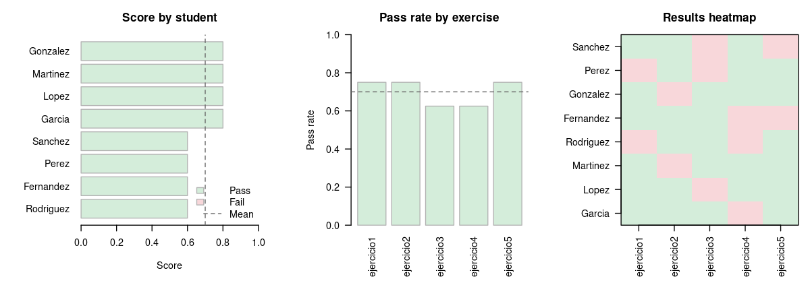

# corrector

[Versión en español](https://anevolbap.github.io/corrector/README.md)

An R package for grading R programming exercises. Each student hands in
one file per exercise (`.R`, `.Rmd` or `.qmd`), the teacher writes the
tests, and corrector grades the whole class at once, on your computer.
It reads the submissions of a Moodle assignment and prepares the
feedback to upload back.

Guides: [Grading
pipeline](https://anevolbap.github.io/corrector/articles/grading-pipeline.html)
· [Cheat-resistant
grading](https://anevolbap.github.io/corrector/articles/cheat-resistant-grading.html)
· [Function reference](https://anevolbap.github.io/corrector/reference/)

## Installation

``` r

# install.packages("remotes")
remotes::install_github("anevolbap/corrector")
```

## Minimal end-to-end example

``` r

library(corrector)

# --- 1. Create a fake submission folder ---
dir.create("submissions/garcia", recursive = TRUE)
dir.create("submissions/lopez",  recursive = TRUE)
dir.create("tests")

writeLines(
  'ceros_cuadratica <- function(a, b, c) {
     d <- b^2 - 4*a*c
     c((-b - sqrt(d)) / (2*a), (-b + sqrt(d)) / (2*a))
   }',
  "submissions/garcia/ejercicio1.R"
)

writeLines(
  'ceros_cuadratica <- function(a, b, c) c(0, 0)',  # wrong
  "submissions/lopez/ejercicio1.R"
)

writeLines(
  'test_ejercicio1_raices <- function() {
     all(ceros_cuadratica(1, 0, -1) == c(-1, 1))
   }
   test_ejercicio1_tipo <- function() {
     is.numeric(ceros_cuadratica(1, 0, -1))
   }',
  "tests/test_ejercicio1.R"
)

# --- 2. Grade ---
results <- grade_submissions("submissions/", test_dir = "tests/")
results
# <grade_results> 4 rows, 2 students, 1 exercises
# Status:
#   pass          3
#   fail          1

# --- 3. Summarise and export ---
grade_report(results)
export_to_html(results, "report.html")
export_to_csv(results,  "grades.csv")
```

## Submissions and tests

One folder per student and one test file per exercise. The test file
name must match the exercise:

    submissions/
    ├── garcia_juan/
    │   ├── ejercicio1.R
    │   └── ejercicio2.Rmd
    └── lopez_maria/
        └── ejercicio1.R

    tests/
    ├── test_ejercicio1.R
    └── test_ejercicio2.R

A test file holds functions named `test_<exercise>_<case>` that return
`TRUE` or `FALSE`. They can also use testthat expectations
(`expect_equal()` and others).

``` r

# tests/test_ejercicio1.R
test_ejercicio1_roots <- function() {
  all(ceros_cuadratica(1, 0, -1) == c(-1, 1))
}
```

- The expected exercises come from the test folder. An exercise the
  student did not hand in is recorded as `missing`, not skipped.
- File names are matched ignoring case: `Ejercicio1.R` counts as
  `ejercicio1`. For `.Rmd` and `.qmd`, the R chunks run.
- Submissions can come as a folder or a `.zip`. Each student’s name
  comes from their folder (`garcia_juan` becomes `Garcia`); change it
  with `student_name_fn`.
- For Moodle, pass the `.zip` from “Download all submissions” with
  `layout = "moodle"`. It works with and without “Download submissions
  in folders”.

``` r

results <- grade_submissions("assignment1-submissions.zip", test_dir = "tests/",
                             layout = "moodle")
```

## What else it does

- **Grades:**
  [`student_scores()`](https://anevolbap.github.io/corrector/reference/student_scores.md)
  gives partial credit and takes weights per test or per exercise;
  [`grade_scale()`](https://anevolbap.github.io/corrector/reference/grade_scale.md)
  turns that score into a 1-10 grade.
- **Feedback:**
  [`export_feedback()`](https://anevolbap.github.io/corrector/reference/export_feedback.md)
  writes one file per student, in Spanish or English;
  [`export_moodle_feedback()`](https://anevolbap.github.io/corrector/reference/export_moodle_feedback.md)
  packs them in a `.zip` to upload to Moodle.
- **Summaries and export:**
  [`grade_report()`](https://anevolbap.github.io/corrector/reference/grade_report.md),
  [`plot_report()`](https://anevolbap.github.io/corrector/reference/plot_report.md),
  [`export_to_csv()`](https://anevolbap.github.io/corrector/reference/export_to_csv.md),
  [`export_to_html()`](https://anevolbap.github.io/corrector/reference/export_to_html.md)
  and
  [`export_to_sheets()`](https://anevolbap.github.io/corrector/reference/export_to_sheets.md).
- **Similar submissions:**
  [`compare_submissions()`](https://anevolbap.github.io/corrector/reference/compare_submissions.md)
  looks for copies, even after renaming variables or changing spacing or
  comments.
- **Time limit and speed:** each test gets `timeout` seconds (default
  10), and `workers` grades several students at once.
- **To try it:**
  [`example_results()`](https://anevolbap.github.io/corrector/reference/example_results.md)
  returns sample results, and
  `system.file("examples", package = "corrector")` holds tests for five
  exercises.

All of this, with examples, in the [Grading
pipeline](https://anevolbap.github.io/corrector/articles/grading-pipeline.html)
guide.



Plots preview

## Security and cheating

corrector is not a sandbox: with the default engine, `callr`, student
code runs as your user and can read and write your files. It blocks the
common tricks (redefining [`all()`](https://rdrr.io/r/base/all.html),
`==` or comparison methods) and notes suspicious code, which
[`grade_report()`](https://anevolbap.github.io/corrector/reference/grade_report.md)
lists for you to check by hand.

- `engine = "isolated"` runs the student code in another process, so
  tricks such as [`attach()`](https://rdrr.io/r/base/attach.html) do not
  change the grade.
- `engine = "container"` does the same inside Docker, with no network
  and only the exercise’s files, so the code cannot reach your computer
  either.

``` r

results <- grade_submissions("submissions/", test_dir = "tests/",
                             engine = "container", workers = 4)
```

How to pick an engine, build the Docker image, and write tests that are
hard to fool: [Cheat-resistant
grading](https://anevolbap.github.io/corrector/articles/cheat-resistant-grading.html).

## Alternatives

corrector is for exercises that students write as files on their own
computer and that the teacher grades afterwards, all at once, with their
own tests, with no server and no student accounts. Other R packages
cover other cases:

- **[gradethis](https://rstudio.github.io/gradethis/)**: checks code
  exercise by exercise inside an interactive
  [learnr](https://rstudio.github.io/learnr/) tutorial, with instant
  feedback. The exercise lives inside the tutorial and needs a Shiny
  server.
- **[exams](https://www.r-exams.org/)**: generates random questions and
  exports them to Moodle, Canvas, PDF and more. It grades answers (a
  number, a choice, a text), not the code the student wrote.
- **[RTutor](https://github.com/skranz/RTutor)**: interactive problem
  sets with automatic checking and progress tracking, in its own format.

corrector is not interactive: students do not see results while they
write, unless you give them the tests to run.

## Contributing

Feedback is welcome. Open an issue on GitHub.
